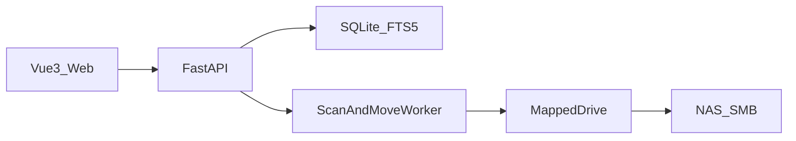

# 图书分类管理系统需求规格说明书

| 项 | 内容 |
| --- | --- |
| 文档状态 | 已确认 |
| 适用阶段 | 需求基线。本文只定义需求与技术约束，不包含实现 |
| 书库规模 | 约 7 万本 |
| 访问方式 | Windows 本机通过已映射的 SMB 盘符访问 NAS，浏览器操作 |

## 1. 背景与目标

NAS 上约有 7 万本电子书。一本书对应一个文件夹，目录可能多层嵌套。使用者在 Windows 上通过已映射的 SMB 盘符（如 `Z:\Books`）访问书库，用浏览器完成分类：把**图书文件夹整体**移动到目标分类目录。

目标：

- 从 OPF 及电子书内部信息提取标签与书目，落入本地索引，查询不依赖实时扫 NAS。
- 用目录树管理分类，支持新建文件夹、拖拽、多选批量移动。
- 移动范围限制在同一书库根目录内，利用同一 SMB 共享上的服务端重命名，避免整本复制。

非目标（第一期不做）：在线补全元数据（豆瓣等）、格式转换、正文全文检索、借阅、多用户权限、回写修改 OPF、删除图书文件。

## 2. 角色与运行方式

- 使用者：单人书库管理员。浏览器可从本机或局域网其他设备打开。
- 进程跑在这台 Windows 电脑上。扫描前用设置中的 SMB 地址、共享名、账户和密码，通过 Windows `net use` 连接 `\\地址\共享`。不自研 SMB 协议，也不在 NAS 上跑服务。
- NAS 操作系统为 Linux，文件名编码 UTF-8，经 Samba 把书库共享给 Windows。
- 书库根是该共享下的一个子路径，必须落在同一个 SMB 共享、同一 Linux 文件系统上。同一共享内的移动应是服务端重命名。若 Samba 因跨文件系统把移动退化为复制，该本记失败并停止，不静默复制。
- Samba 登录账号需要对书库有读、写、重命名权限。权限不足时该条失败并记下原因（权限），不反复重试。
- 第一期一个书库根目录。数据模型预留多书库，界面先不做。
- 启用简单口令。服务能改 NAS 上的目录位置，不能裸奔在局域网。

## 3. 技术方案（作为需求约束）

- 后端：Python 3.12、FastAPI。解析用 lxml（OPF）、ebooklib（EPUB）、pypdf（PDF）。
- 索引：本机 SQLite（WAL + FTS5）。7 万条书目足够，查询走本地库。封面缩略图也缓存在本机。
- 任务：单机后台线程/异步任务即可，不用 Celery。扫描与批量移动可暂停、可取消，进度用 SSE 推到页面。
- 前端：Vue 3 + Vite + TypeScript。列表虚拟滚动。拖拽用 HTML5 DnD。
- 路径：启用 Windows 长路径（`\\?\` 前缀）。新建文件夹时过滤 Windows 非法字符；已存在的超长或特殊路径只读入索引，不在扫描阶段改名。

选择本机映射盘而不是 NAS Docker 或自研 SMB 客户端：移动由 Windows 对同一共享发起重命名，断线重连交给系统；实现和排错都更简单。

## 4. 图书与分类的判定

扩展名默认：`epub`、`pdf`、`mobi`、`azw`、`azw3`、`azw4`、`kfx`、`djvu`、`cbz`、`cbr`、`fb2`。可配置。`txt`、`doc` 默认不算书，避免说明文件被当成书。

目录 D 是**图书文件夹**，当且仅当其直接子文件中有 `metadata.opf`，或至少有一个默认扩展名文件。

- 只有子目录、自己没有直接图书文件的目录，是**分类目录**。
- 子目录若自己也满足图书条件，子目录是另一本书。
- 图书文件夹内部的封面、opf、附件随该书一起移动。
- 若父、子同时被选中，只移动最外层文件夹，避免重复移动。
- 移动分类目录会带走其下全部图书，必须二次确认。
- 路径比较按 Samba 返回的原始大小写，区分 `Book` 与 `book`。新建或移动前，在目标父目录内做大小写精确的重名检查。
- 已存在、Windows 无法表示的文件名只读入索引，扫描阶段不改名。

元数据优先级（同一字段）：

1. 图书文件夹内的 `metadata.opf`（含 Calibre 标签、作者、丛书）
2. 主文件内部：EPUB OPF，其次 PDF Info/XMP；MOBI/AZW 只做尽力解析
3. 文件夹名/文件名启发式（如 `作者 - 书名`、`书名 (丛书 #序号)`）
4. 用户手工改过的字段加锁，之后扫描不得覆盖

主文件：优先 epub，其次 pdf，再其他。多格式同夹视为一本书，格式列表分别记录。

## 5. 功能需求

### 5.1 书库设置

- 配置 SMB 地址、共享名、共享内子路径、账户和密码。密码只保存在本机索引库，读取设置时不回传，只显示是否已保存。
- 保存时连接共享并检查书库目录可读写。扫描开始时如果连接已断开，用已保存的账户重新连接。
- 未配置 SMB 时，仍可填写本机或已映射路径作为书库根。
- 包含/排除规则（glob）。
- 默认排除且可关闭：`@eaDir`、`#recycle`、`@Recycle`、`.Trash`、`.Trash-*`、`lost+found`、`#snapshot`。
- 不跟随指向书库根之外的符号链接。
- 可改识别扩展名。
- 显示根路径、书目数量、上次扫描时间、索引库位置。

### 5.2 扫描与索引

分三阶段，全部后台执行：

1. 走目录，识别图书文件夹与分类目录，写入路径、大小、mtime、直接文件列表。可用文件名先填低可信度标题。
2. 读取已有 `metadata.opf`（小文件，优先）。
3. 对其余书解析内部元数据。按「缺少 OPF」优先。以大小 + mtime 判断是否跳过已解析文件。

要求：进度（已遍历目录、已识别书、已解析、失败数）、失败明细可导出、可暂停/继续/取消、SMB 断开时暂停并提示重试。解析并发默认 4，可配置，避免打满 NAS。

身份：第一期以「书库内相对路径」为书的位置。本系统发起的移动必须同步改索引路径。外部挪动的书在下次扫描中按标题 + 作者 + 主文件大小 + 文件头哈希做尽力重新关联；关联不上则视为新书，旧路径标记缺失。不在 NAS 上写旁路 id 文件。

### 5.3 检索与浏览

- 检索字段：书名、作者、丛书、标签、ISBN、文件夹名。FTS，目标是常见筛选在 200ms 内返回第一页。
- 筛选：标签、作者、丛书、语言、格式、解析来源、是否未分类、路径前缀。带数量。
- 排序：书名、作者、路径、mtime、丛书序号。分页或虚拟列表，禁止一次渲染 7 万行。
- 详情：元数据及来源、可信度、文件列表、封面、当前路径。可改书名/作者/标签/丛书并锁定。

未分类定义：图书的父目录仍落在可配置的「收件箱」路径下，或父目录未被标记为分类目录。默认把扫描发现的、尚无分类标记的父目录视为未分类，用户可把某目录标成「已是分类」。

### 5.4 分类与移动

双栏：左侧分类树，右侧当前目录下的书（可切换含不含子目录）。

- 原始目录在 `smb://192.168.31.88/书库/`。分类文件夹建在 `smb://192.168.31.88/books` 下，例如 `books/小说`，不建在书库里，也不建到某一本书里面。
- 重命名分类文件夹。
- 图书从书库手动移入 books 下的分类文件夹：拖到该目录，或在「移动到…」里选择 books 下已有分类，也可以填写新分类名，确认后才创建并移入。不会因为标签是小说就自动移动。两个共享若被系统看成不同文件系统，该本失败并停止，不复制文件。
- 仅允许删除空分类目录。不删除图书文件。
- 拖拽一本或多本到目标分类目录。
- 多选后「移动到…」。
- 批量超过可配置阈值（默认 50）时先展示目标路径和数量，确认后执行。
- 同名文件夹已存在：默认跳过该项并记入失败，可选自动加 ` (2)` 后缀。不提供「合并进已有文件夹」。
- 任务进度：成功、跳过、失败。失败保留原因（占用、权限、断线、同名）。
- 操作日志可追溯：时间、源路径、目标路径、数量、结果。
- 撤销：对仍保持原移动结果的批次做反向重命名。目标已被再改或文件已变，则该条不可撤销并说明原因。

所有目标路径必须落在已连接的书库或分类共享内。

### 5.5 按标签自动分类

规则按优先级排序，先匹配先生效：

- 条件：标签、作者、丛书、语言、格式、当前路径前缀，可组合（全部满足）。
- 动作：移动到某一分类目录。可选「目标不存在则创建」。
- 执行前强制预览：命中数量、样例、将创建的目录。可只作用于当前选择或全部未分类。
- 规则存本地库，可启用/停用/排序，不自动在扫描结束时挪文件。自动移动必须人工触发。

### 5.6 标签管理

- 标签表及使用次数。
- 全局重命名、合并（A 并入 B）。
- 给书增删标签，并锁定标签字段。
- 从标签行一键生成「该标签 → 同名分类目录」规则草稿，仍须预览后执行。

### 5.7 封面

- 优先使用图书文件夹里的 `cover.jpg`。直接放在该文件夹下，或放在其中不是另一本书的子目录里。没有时再用其他封面图，最后才用 EPUB/PDF 首页。
- 列表和详情按可见区域取缩略图，缓存在本机。生成失败显示占位，不阻断扫描。

## 6. 数据实体

- 书库：根路径、排除规则、扩展名。
- 目录：相对路径、父目录、是图书夹还是分类目录、是否标为已分类。
- 书：标题、副标题、丛书、序号、语言、出版社、出版日期、ISBN、简介、评分、来源、字段锁、主格式、大小、mtime、相对路径。
- 作者、标签：多对多。
- 文件：相对路径、扩展名、大小、mtime、是否主文件。
- 规则：优先级、条件 JSON、目标相对路径、是否自动建目录、启用。
- 任务：类型（扫描/移动）、状态、进度、错误。
- 操作及明细：用于日志和撤销。

手工锁粒度到字段：标题、作者、标签、丛书可分别锁定。

## 7. 页面

- 书库：目录树 + 图书列表 + 详情抽屉。
- 未分类。
- 标签。
- 分类规则（编辑、预览、执行）。
- 任务中心：扫描与移动进度、失败列表。
- 操作日志与撤销。
- 设置：根路径、口令、并发、批量确认阈值、扩展名、排除规则。

## 8. 非功能与风险

- 首次全量解析可能持续数小时，界面必须可离开任务中心继续浏览已入库部分；已入库即可搜，不必等解析结束。
- 目录遍历与元数据解析失败互不影响：单本失败记日志并继续。
- 索引文件放本机固定目录，启动时备份上一份 SQLite。不把数据库放 NAS。
- 风险：SMB 抖动、长路径、同名冲突、父文件夹与子书嵌套、文件被占用、外部改动导致撤销失效。另有 Linux 大小写敏感与 Windows 客户端大小写不敏感不一致、Samba 权限不足、跨文件系统移动退化为复制、符号链接逃出书库根。对应策略已写在第 2、4、5 节。

## 9. 验收标准

- 对混合样本（含 `metadata.opf`、纯 epub、纯 pdf、无元数据只能靠文件名、父子嵌套各一本）识别正确，且父书内部封面不被当成另一本书。
- 7 万规模下，按标签/作者筛选第一页可用；扫描过程中已入库的书可搜索。
- 拖拽、新建文件夹、超过阈值的批量移动、同名跳过、失败可解释，且无法把文件夹移出书库根。
- 一条标签规则预览数量与实际移动数量一致；执行后索引路径与磁盘路径一致。
- 手工改标签后再次扫描，锁定字段不变。
- 撤销一次成功的批量移动后，文件夹回到原路径。

## 10. 分期

- 第一期：设置、三阶段扫描、检索浏览、详情与字段锁、目录树、新建/重命名、拖拽与批量移动、任务进度、操作日志、口令。
- 第二期：规则引擎与预览执行、标签合并、撤销、封面缓存、未分类标记。
- 第三期：缺失书重新关联、重复书提示、可选 OPF 回写。
